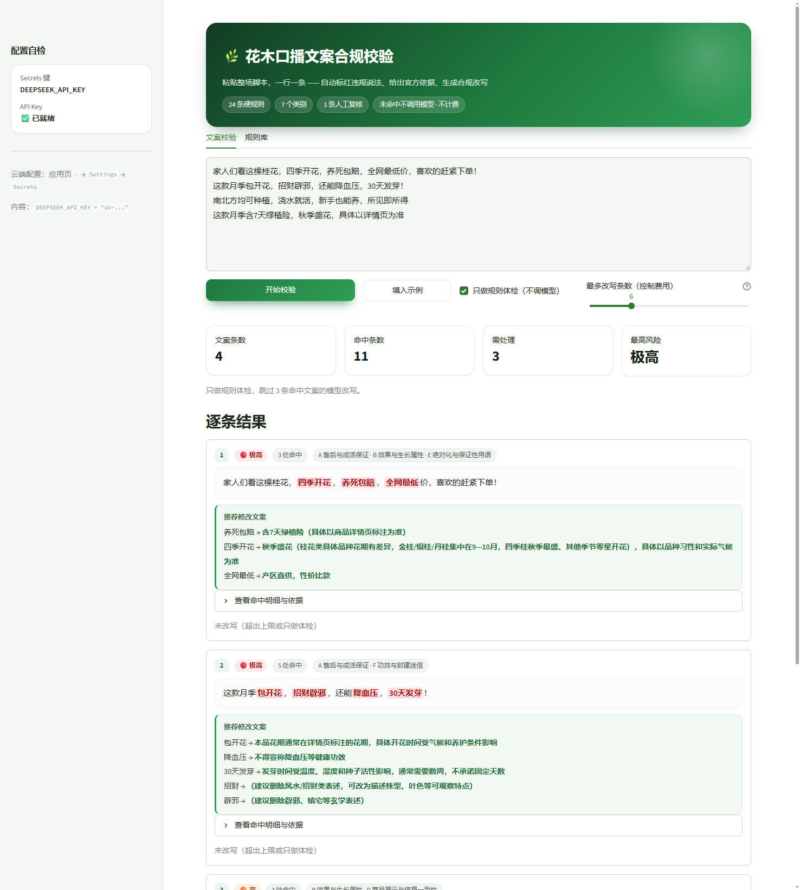

# huamu-check —— 沭阳花木抖音口播文案合规检查

硬规则先扫，命中才调 DeepSeek 改写。**没命中就不发请求、不花钱。**

```
文案 ──> rules.json 正则扫描 ──0 命中──> 直接返回“无需改写”
                    │
                    └──≥1 命中──> 取相关替换组 ──> DeepSeek 改写 ──> 逐条说明 + 改写稿
```

三个文件：

| 文件 | 作用 |
|---|---|
| `rules.json` | 6 条硬红线（R001–R006），带风险等级、依据、官方出处 |
| `replacements.json` | 按违规类型分组的合规替换说法 |
| `check.py` | 主脚本：扫描 / 拼 prompt / 调模型 / 命令行 |

外加网页版：

| 文件 | 作用 |
|---|---|
| `app.py` | Streamlit 界面，**复用 check.py 的逻辑**，不重复实现 |
| `test_app.py` | 界面冒烟测试（AppTest，不用开浏览器） |
| `.streamlit/config.toml` | 主题色 + 关闭使用统计 |
| `.streamlit/secrets.toml.example` | 云端部署的 Key 模板 |

## 网页版（Streamlit）

```powershell
pip install -r requirements.txt
streamlit run app.py           # 打开 http://localhost:8501
```



界面分三个标签页：

- **单条校验**：粘贴 → 命中列表（按风险排序，原文命中片段标红）→ 逐条依据 → 改写稿（可编辑、可下载）
- **批量体检**：一行一条，只跑规则不调模型，表格里看每条命中数和最高风险
- **规则库**：把 `rules.json` 的 6 条正则和依据直接展示出来，方便运营自查

省钱设计：命中 0 条时按钮直接给“未命中”，不构造 client、不发请求；勾选
「只做规则体检」则完全离线。

**部署到 Streamlit Community Cloud**：把 `app.py`、`check.py`、`rules.json`、
`replacements.json`、`requirements.txt`、`.streamlit/config.toml` 推到 GitHub，
在 share.streamlit.io 选仓库和 `app.py`，然后去 Settings → Secrets 填：

```toml
DEEPSEEK_API_KEY = "sk-你的key"
```

`app.py` 里的 `get_api_key()` 已经按 **Secrets → 环境变量 → .env** 的顺序取，
本地和云端不用改代码。

## 安装

```powershell
pip install -r requirements.txt
```

## 配置

只需要 `DEEPSEEK_API_KEY`，**仅在命中规则时才会用到**。脚本会依次在
`huamu-check/`、项目根目录、上两级目录里找 `.env`：

```
DEEPSEEK_API_KEY=sk-你的密钥
```

也可以直接设环境变量，或调用时传 `api_key=`。

## 用法

```powershell
# 检查 + AI 改写
python check.py "家人们看这棵桂花，四季开花，养死包赔，全网最低价，喜欢的赶紧下单！"

# 只体检规则，不调模型（零成本，适合先批量筛一遍）
python check.py "文案" --no-ai

# 机器可读，方便接到自己的工具链里
python check.py "文案" --json --no-ai

# 批量：一行一条口播稿
python check.py --file 稿件.txt --no-ai

# 离线自检（不联网）
python check.py --selftest
```

作为库调用：

```python
from check import check, lint

lint("养死包赔")                  # 只拿命中列表
check("养死包赔", rewrite=False)   # {"text", "hits", "advice", "rewritten"}
check("养死包赔")                  # advice 里是模型的“逐条说明 + 改写文案”
```

## 输出长什么样

```
硬规则命中：3 条
  [极高] R001  命中：养死包赔
       位置：这棵桂花，四季开花，【养死包赔】，全网最低价，喜欢的
       依据：抖音《关于鲜花绿植商品服务虚假的专项治理公告》2026-09-02
```

命中按**风险**排序（极高 → 高 → 中），同风险按出现位置排；`位置` 会框出命中片段，
方便商家在稿子里定位。命中 0 条时直接结束，不构造 client、不发网络请求。

## 和原始版脚本的差别（修掉的问题）

| 问题 | 后果 | 现在 |
|---|---|---|
| `re.findall` 只返回捕获组 | R001 报“包赔”而不是“养死包赔”；R002 报“不赔”，**导致选不到「售后承诺类」替换组**，模型拿不到参考 | 改用 `finditer` + `group(0)`，命中片段和分组选取都正确 |
| 模块级创建 client | 没配 key 时 `import check` 就崩 | 改成懒加载，`--no-ai` / 未命中路径完全不需要 key |
| 没有命令行入口 | 只能改 `sample` 变量再跑 | 支持参数 / stdin / `--file` 批量 / `--json` / `--selftest` |
| Windows 控制台 GBK | 中文输出乱码 | 启动时把 stdout/stderr 切到 UTF-8 |
| 规则正则写错只在运行时炸 | 难排查 | `load_rules()` 编译期就报错并指出是哪条 |
| 无命中时的提示语 | — | 保留并补了一句“语义层风险仍需人工判断” |

另有一处**故意**和常见写法不同：`app.py` 没有把 `check.py` 的代码复制一份，而是
`import check`。复制粘贴的版本改完规则容易两边不同步——命令行说合规、网页说违规。
现在只有一份逻辑，界面只负责展示。

## 自检

```powershell
python check.py --selftest    # 规则匹配 / 替换分组 / 排序，12 项
python test_app.py            # 界面冒烟测试（AppTest，不开浏览器，不调模型）
python test_app.py --with-ai  # 同上，但改写那段真的调一次 DeepSeek，验证端到端
```

## 规则库怎么加

往 `rules.json` 的 `rules` 数组追加一条即可，字段固定：

```json
{
  "id": "R007",
  "pattern": "你的正则",
  "risk": "极高 | 高 | 中 | 低",
  "reason": "违反了什么、平台怎么认定",
  "source": "官方公告名称 + 日期"
}
```

可选字段 `exclude`：命中处前后若出现这些词就忽略，用来压误报（见下）。

替换表往 `replacements.json` 对应分组追加 `违规原词: 合规说法`。
**分组名要和 `check.py` 里的 `GROUP_KEYWORDS` 对得上**，否则不会被取到——
新增分组时记得同步加一组关键词。

## 每条规则实际覆盖什么

直播里真正高频的是变体，不是原始词。每条正则都放宽了，允许中间夹少量虚词
（`冻坏了可不管`、`四季都开花`、`养死了也不包赔`），但**遇到句号逗号就断开**，
避免跨句误配。

| 规则 | 覆盖的写法（举例） |
|---|---|
| R001 | 养死包赔 / 死苗补发 / 枯了包换 / 包成活 / 保活 / 没养活补发 |
| R002 | 冻坏不赔 / 冻死了没人赔 / 冻伤不管 / 冻了自理 |
| R003 | 四季开花 / 全年挂果 / 一年四季开花 / 开三季 / 常年有花 |
| R004 | 全网最低 / 全场最低价 / 史上最低 / 最便宜 / 销量第一 / 100% / 百分百 / 国家级 |
| R005 | 南北方均可种植 / 全国各地都能种 / 哪里都能养 / 任何地方都能栽 |
| R006 | 浇水就活 / 给点水就能活 / 见土就活 / 养不死 / 随便养都活 |

## 已知的误报与调优

- ~~R004 的 `第一` 会命中“第一次养花”~~ —— 已用负向断言修掉：
  `第一(?![次步年天批眼周月个种件])`，序数词不再误报，`销量第一` 仍然命中。
- **`四季常绿` 不再命中**。桂花、茶花、黄杨本身就是常绿树种，说“四季常绿”是事实。
  R003 只管花期/挂果。代价是：玉兰（落叶）若被写成“四季常绿”会漏掉，这属于品种知识，
  交给改写环节的 prompt 兜底，不硬拦。
- `100%` 仍会命中“100% 原土发货”这类事实描述，也会命中“100% 成活”。
  按业务实际决定是否加 `exclude`。
- 规则库只有 6 条正则，**管不了语义层风险**：暗示疗效、贬低同行、
  “基地直供”但没有基地、限时秒杀价不实等，仍需人工过一遍。
  `--no-ai` 的体检结果只是第一道闸。

- **`四季开花` 的替换句是桂花口味**（写着“金桂/银桂/丹桂/四季桂”）。如果文案说的是
  玉兰、牡丹而不是桂花，模型可能把这句整体搬过去，变成另一种虚假宣传。两种解法：
  1. 在替换表里按品种拆键（`桂花四季开花` / `玉兰四季开花`），让 `GROUP_KEYWORDS` 命中更细；
  2. 让模型只用中性句“具体花期以详情页为准”——实测它现在会优先选品种专用的那条，
     但这依赖模型的判断，不是硬保证。

  发布前重点看这一处：**改写稿里的品种名和花期是否还在说同一件事。**

## 排障

| 现象 | 原因 |
|---|---|
| `缺少 DEEPSEEK_API_KEY` | 只在命中规则且要改写时抛；`.env` 找不到或没写 key |
| `401 Authentication Fails` | Key 无效/已删除。DeepSeek 的 Key 一定是 `sk-` 开头，到 <https://platform.deepseek.com/api_keys> 重新申请 |
| 中文乱码 | 已强制 UTF-8；若仍乱码，检查终端字体或 `chcp 65001` |
| 规则不生效 | 检查 `rules.json` 是否是合法 JSON（`--selftest` 会先编译全部正则） |
| `streamlit: command not found` | 没装或不在 PATH，用 `python -m streamlit run app.py` |
| 网页打不开 / 端口占用 | `streamlit run app.py --server.port 8502` 换端口 |
| 网页点了校验报 401 | Secrets / `.env` 里的 key 无效，换 key 后**刷新页面**（旧 client 已缓存） |
